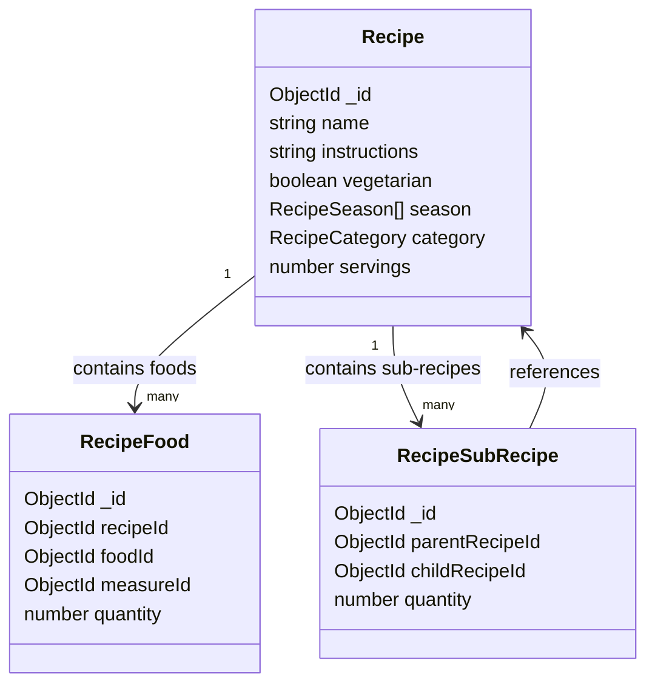

# Recipe Domain Model

This document describes the Recipe domain.
The Recipe domain depends on the Food domain.

## MongoDB Collections
- recipes
- recipeFoods
- RecipeSubRecipe

## Rules
- Recipes never store nutritional values
- RecipeFood is a pivot collection between Recipe and Food
- RecipeSubRecipe allows a recipe to reference another recipe
- Sub-recipes are full recipes with their own ingredients and instructions
- Recipe domain depends on Food domain
- Food domain must never depend on Recipe domain
- Cycles between recipes must be prevented (no recursive loops)
- Personal weekly plans have a unique userId/weekStart (Monday string), targetServings (default 24), totalServings, shortage, surplus and items.
- Plan items snapshot recipeId, recipeName, servings, source and cookedAt; no duplicates or preparation days.
- Completion preserves choices; random/replacement candidates are approved seasonal MAIN or OTHERS recipes not cooked in S−1/S−2 and absent from the target plan (including the recipe being replaced). Manual additions accept any approved recipe.
- Current/next weeks are editable; past weeks are read-only except that cooking can be marked/unmarked in the previous week. Cooking is editable only in the current and previous weeks, based on the Europe/Paris calendar.
- Shopping lists belong to user/week and snapshot exactly two stores and items of kind ingredient/free. Both kinds have itemKey, foodName, store, checked and inStock; only ingredients require foodId, category, quantity and unit.
- User.shoppingStores provides defaults for new lists. See ../shopping-lists-frontend.md and backend docs/api/weekly-recipe-plans.md.

Completion targets equal recipe counts of VEGETARIAN versus NON_VEGETARIAN/FLEXIBLE,
including existing manual choices using current recipe statuses. Prefer the minority
group, randomly break ties, and fall back if a group is exhausted. Stop at the serving
target; preserve existing choices. Missing/unknown statuses do not count in the ratio.
Replacement applies the same group preference after excluding the replaced item from
the balance counts, then randomly selects within the preferred group (or the other
group if exhausted). Clicking Remplacer directly sends
`PUT /api/weekly-recipe-plans/:weekStart/recipes/:recipeId/replace` with `{}` instead
of a destination recipeId; the server returns the complete updated plan. There is no
replacement selector. If no recipe is eligible, HTTP 400 displays
`Aucune recette admissible pour remplacer cette recette.` and the plan stays unchanged.
Replacement remains disabled for cooked items and past weeks. Manual selection stays
available through removal and the existing add selector.
